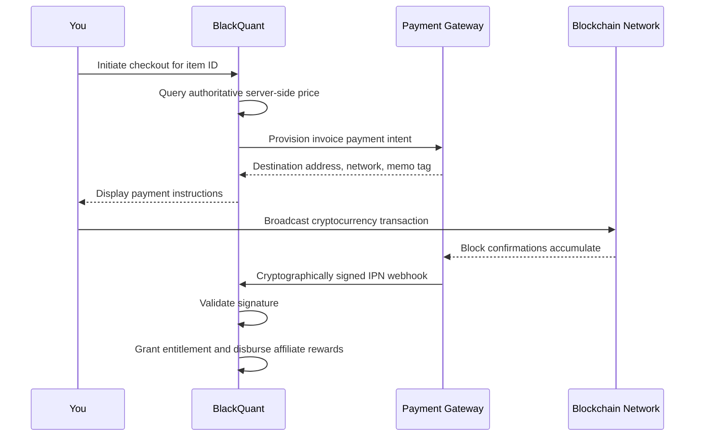

BlackQuant supports two payment mechanisms for catalog purchases:

| Route | When to Use |
| --- | --- |
| **USD Account Balance** | You already hold credited funds in your account ledger |
| **Direct Crypto Checkout** | Your balance is short, or you prefer paying per transaction on-chain |

## Account balance payments

When paying via your balance, the system debits your ledger and activates the entitlement within a single atomic database transaction: both operations succeed together or fail safely.

If your available balance is insufficient, the checkout prompts you to top up or complete a direct cryptocurrency checkout.

## Direct cryptocurrency checkout

Checkout provisions a dedicated **payment intent**: an on-chain address for a chosen asset, linked specifically to that individual invoice rather than your general balance.

### Decoupled session-free settlement

Purchase settlement logic operates without active session dependencies. While browser purchases originate from an authenticated user, crypto checkout webhooks settle asynchronously from payment gateway notifications.

Both paths invoke the identical backend fulfillment pipeline, ensuring consistent transactional behavior.

## Fulfillment criteria

A payment intent is fulfilled upon meeting native blockchain confirmation thresholds. Entitlements activate automatically once confirmed: not when the transaction is broadcast, and not when the first block appears.

<Info>
Confirmation requirements match our standard deposit schedules, ranging from 1 block on XRP Ledger to 32 blocks on Solana. The complete schedule is detailed in [Fund your account](/getting-started/fund-your-account#supported-assets).
</Info>

## Essential payment precautions

<Danger>
**Network selection is fixed.** Checkout addresses are provisioned for a specific asset on an exact decentralized network. Broadcasting over an unsupported network results in permanent loss.

**Destination memos and tags are required where indicated.** If an invoice displays an extra memo or tag, omitting it prevents automatic transaction attribution.
</Danger>

## Selecting the right payment approach

* **Fund your account balance in advance** if you plan to launch Smart Executors, scale multiple positions, or prefer consolidated ledger accounting.
* **Use direct crypto checkout** if you are purchasing a single subscription or prefer not to maintain unallocated balances.

Direct checkout carries no added fees or pricing penalties.

## Resolving unsettled checkouts

1. Verify on a native block explorer that your transaction reached the required confirmation threshold.
2. Review the payment status in the invoice console. Detailed states are listed in [Troubleshooting](/resources/troubleshooting#deposit-states).
3. If an invoice indicates `PARTIALLY_PAID`, contact the [Help Desk](/platform/knowledge-and-help) with your blockchain transaction hash.

If a payment confirms after an invoice window expires, the transaction remains tracked in our gateway ledger: contact support for manual reconciliation.
