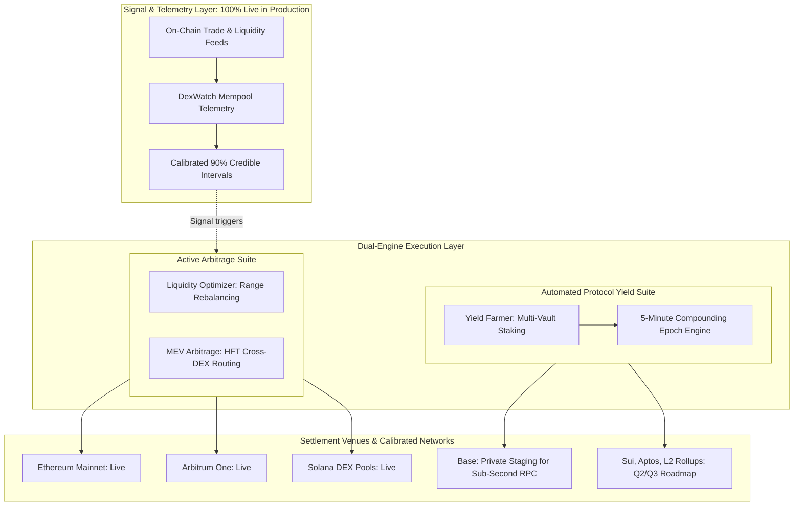

## Technical stack

| Concern | Implementation |
| --- | --- |
| Framework | Next.js 16 (App Router, Turbopack, React 19) |
| Styling | Tailwind CSS v4, CSS-first token configuration |
| Component Primitives | shadcn/ui built on Radix UI primitives, Lucide icons |
| Client State | Zustand, synchronized from authenticated session |
| Server State | TanStack Query for cache invalidation and queries |
| Authentication | Auth.js (NextAuth v5) integrated with Prisma adapter |
| Database Layer | PostgreSQL managed via Prisma ORM |
| Animation Runtime | GSAP with ScrollTrigger and Lenis smooth scrolling |
| Theme Provider | next-themes (light, dark, and system modes) |
| Environment Validation | Zod schema validation in `lib/env.ts` |

## Codebase layout

```
app/            App Router endpoints, Server Actions, layouts
  api/          Route handlers: webhooks, live event streams, health checks
  dashboard/    Authenticated user interface and execution controls
components/
  ui/           shadcn/ui primitive components
  dashboard/    Dashboard modules, smart executor consoles, positions
  landing/      Marketing and informational landing modules
lib/            Core domain logic: auth, catalogue, referral, KYC, deposit, executors
prisma/         PostgreSQL database schema and migrations
proxy.ts        Edge authentication middleware
docs/           GitBook documentation repository
```

## Production operational status

* **Signal Ingestion & Telemetry**: Core DEX liquidity telemetry, market watcher daemons, and Bayesian reliability scoring models (dynamic 90% credible intervals) are 100% operational in production.
* **Execution Routing**: Our automated execution router operates in production under a gated, whitelisted canary phase with internal accounts and pilot liquidity providers. The public-facing tier currently serves live high-conviction signal streaming.
* **End-to-End Tracing & Replay**: The infrastructure maintains microsecond-level replay tracing from DexWatch signal generation, through mempool broadcast, to final on-chain block settlement.

## Dual-engine execution runtime

The execution tier connects quantitative signals to decentralized market venues. BlackQuant separates execution into two specialized engines:



### 1. Active Arbitrage Suite
* **Liquidity Optimizer**: Automated liquidity rebalancing and range arbitrage across decentralized exchange pools.
* **MEV Arbitrage**: Senior high-frequency trading (HFT) strategy capturing cross-market price discrepancies and optimal transaction routing opportunities.
* **Settlement**: Interacts directly with on-chain DEX order books and automated market maker pools.

### 2. Automated Protocol Yield Suite
* **Yield Farmer**: Non-custodial capital allocation into vetted decentralized finance vaults and staking pools (Aave v3 Prime, Kamino Automated Yield, Marinade Validator Staking, and Curve Stability Pools).
* **Compounding Epoch Engine**: Executes automated harvest cycles every 5 minutes (288 epochs per day) with non-custodial cryptographic reserve verification. Accrued yield can be continuously auto-compounded or directed to daily balances.
* **Safety & Security**: Contract foundations audited by OpenZeppelin and Trail of Bits, ensuring strict non-custodial constraints and protected principal accounting.

## Delegated non-custodial execution model

For automated capital deployment, BlackQuant adheres to a delegated non-custodial model:

* **Session-Delegated Key Permissions**: Powered by ERC-4337 account abstraction and scoped session keys.
* **Predefined Risk Boundaries**: Users configure explicit risk constraints before starting an executor, including maximum slippage tolerance, position sizing ceilings, and stop-out limits.
* **Autonomous In-Bounds Routing**: Within defined boundaries, execution runs autonomously 24/7 across multi-factor ranking and optimal routing algorithms.
* **Automated Fail-Safe Protection**: Any out-of-band market anomaly (such as abnormal pool slippage, sudden liquidity collapse, or unwhitelisted token rebalancing) triggers an immediate execution halt requiring explicit user one-click re-authorization.

## Cryptographic separation of concerns

BlackQuant maintains an absolute separation between trading capital and operational SaaS payment rails:

1. **Trading Capital**: Remains strictly non-custodial at all times, secured in self-custodied user wallets or dedicated smart contract vaults. The platform never co-mingles, borrows against, or takes custody of user assets.
2. **Operational Payment Rails**: Our off-chain ledger tracks subscription plan utilization, performance attribution, and affiliate commissions, reconciling platform fees via decentralized payment gateways without ever touching user principal.

## Network pipeline calibration status

| Network | Status | Operational Focus |
| --- | --- | --- |
| **Ethereum Mainnet** | Production | High-conviction arbitrage routing and pool rebalancing |
| **Arbitrum One** | Production | Low-gas DEX arbitrage and Curve stability pools |
| **Solana** | Production | High-throughput DEX pools, Kamino vaults, and Marinade staking |
| **Base** | Private Staging | Sub-second RPC latency optimization and Aave v3 Prime vaults |
| **Sui & Aptos** | Q2/Q3 Roadmap | Parallelized Move VM liquidity integration |
| **Hyper-Liquid L2s** | Q2/Q3 Roadmap | High-frequency on-chain order book settlement |

## Engineering principles

Business logic resides in `lib/`, strictly separated from presentation components:

* **Server-side price authority**: All catalog items and prices are defined in `lib/catalogue.ts`. Purchase actions accept an item identifier and retrieve the authoritative price server-side, preventing client-side parameter manipulation.
* **Session-independent settlement**: Core ledger mutations in `lib/purchase.ts` operate on user IDs rather than HTTP sessions. Both browser actions and asynchronous payment processor webhooks execute through the exact same idempotent accounting logic.
* **Atomic ledger consistency**: Account balances are derived from immutable ledger rows. Debits, credits, and entitlement grants are executed within single database transactions to prevent race conditions.
* **Real-time push delivery**: Server-Sent Events (`/api/deposit/stream` and `/api/signal-engine/stream`) broadcast updates in real time without client polling.

## Related documentation

* [The custody model](/security/custody-model)
* [Corporate and regulatory positioning](/security/corporate-and-regulatory)
* [Audit reports](/security/audit-reports)
* [Webhooks](/webhooks)
