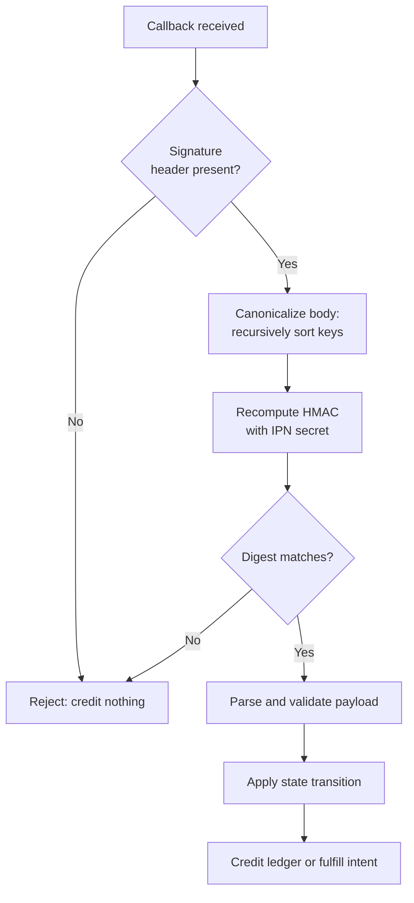

## `POST /api/deposit/ipn`

<Danger>
**This is the sole endpoint in the platform where an account balance increases.** Signature validation ensures requests cannot be spoofed. The handler validates cryptographic proofs before modifying internal records.
</Danger>

## Signature verification

The payment gateway cryptographically signs every webhook callback. The application verifies the signature by canonicalizing the JSON payload (recursively sorting object keys) and computing an HMAC digest against the shared IPN secret:

Canonicalization is essential: JSON key ordering varies across serialization runtimes, so signing raw bytes would result in false verification failures on identical payloads.

## Response status codes

Unrecognized or duplicate callbacks intentionally return HTTP **200**.

Returning error codes (4xx or 5xx) causes gateways to execute retry loops indefinitely. A 200 response indicates the payload was successfully *received and processed*, not necessarily that a balance was credited.

## State transitions

Deposit transitions move strictly forward. An out-of-order callback carrying an earlier state cannot regress a transaction from `CONFIRMED` to `CONFIRMING`:

| State | Lifecycle Stage |
| --- | --- |
| `WAITING` | Address issued; awaiting on-chain detection |
| `CONFIRMING` | Detected in blockchain mempool |
| `CONFIRMED` | Required block confirmations reached; balance credited |
| `PARTIALLY_PAID` | Transaction value falls short of expected amount |
| `FAILED` | Transaction failed or dropped from mempool |
| `EXPIRED` | Payment window elapsed prior to broadcast |

Raw callback payloads are preserved alongside transaction events, enabling precise auditing and forensic reconciliation.

## Callback fulfillment paths

* **Deposit fulfillment**: Creates an immutable ledger entry and increments available account balance.
* **Payment intent fulfillment**: Fulfills on-demand crypto checkout invoices by activating plan entitlements and distributing affiliate commissions. Handlers accept user identifiers rather than session tokens, operating cleanly in background worker environments.

## Operational engineering standards

* **Idempotency**: Unique payment references ensure replayed callbacks cannot trigger duplicate crediting.
* **Ordering resilience**: Forward-only state transition logic prevents race condition anomalies.
* **Retry tolerance**: Handlers safely process repeated deliveries without side effects.
* **Event streaming**: Successful state updates immediately trigger Server-Sent Event pushes to active client dashboards.

## Related documentation

* [Architecture](/architecture)
* [Fund your account](/getting-started/fund-your-account)
