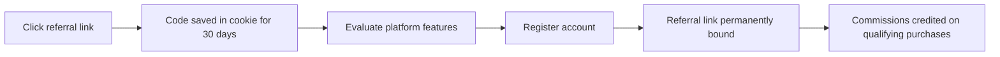

## Sign-up methods

### Email and password

Navigate to **Sign up**, enter your email address, and select a strong password. Email addresses are normalized (lowercased and trimmed) to prevent duplicate accounts.

### GitHub OAuth

Where GitHub sign-in is enabled, you can authenticate using your GitHub developer account via the OAuth action button.

<Info>
Accounts initialized via GitHub OAuth do not have a password set by default. The standard sign-in form returns a generic authentication error to prevent email enumeration.

To add a password later, navigate to [Reset credentials](/security/account-recovery#changing-your-password).
</Info>

## Referral link attribution

Referral links take the format `/ref/<code>`. Visiting an affiliate link stores the code in a secure browser cookie for **30 days** before directing you to the dashboard.

The 30-day window ensures that affiliates receive credit even when users evaluate the platform over multiple sessions prior to completing registration.

Upon registration, the affiliate code binds to the referring account permanently.

Referral codes consist of eight characters generated from an unambiguous character set (omitting `0`, `o`, `1`, `l`, and `i`).

## Password security guidelines

We recommend using strong, unique credentials:

| Recommended Practice | Discouraged Practice |
| --- | --- |
| Generate a random password via a password manager | Reusing passwords from other exchanges or email accounts |
| Use a multi-word passphrase with high entropy | Modifying existing passwords with predictable suffixes |
| Store single-use 2FA recovery codes in a secure vault | Storing 2FA recovery codes in unencrypted notes |

## Immediate account entitlements

* Account created with a verified **$0.00 USD ledger balance**.
* Instant personal **referral code** ready to share via [Referral Hub](/platform/referral-hub).
* Access to the full dashboard, funding flows, and strategy documentation.

## Feature prerequisites

| Feature | Requirement |
| --- | --- |
| Deposit cryptocurrency | No prerequisites |
| Subscribe to a signal plan or Smart Executor | Account balance or direct crypto checkout |
| Withdraw funds to external wallet | Completed [Identity verification](/verify-your-identity) |
| Password modifications | Email confirmation code |

## Next step

Before depositing funds, configure two-factor authentication to ensure your assets and session keys are secured from day one.

* [Secure your account](/secure-your-account)
