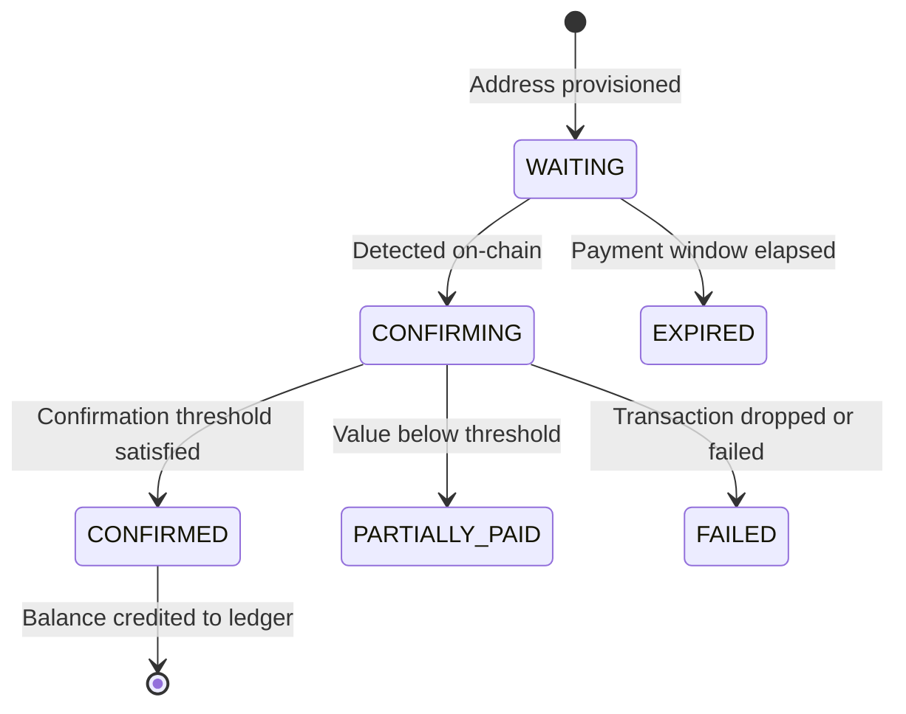
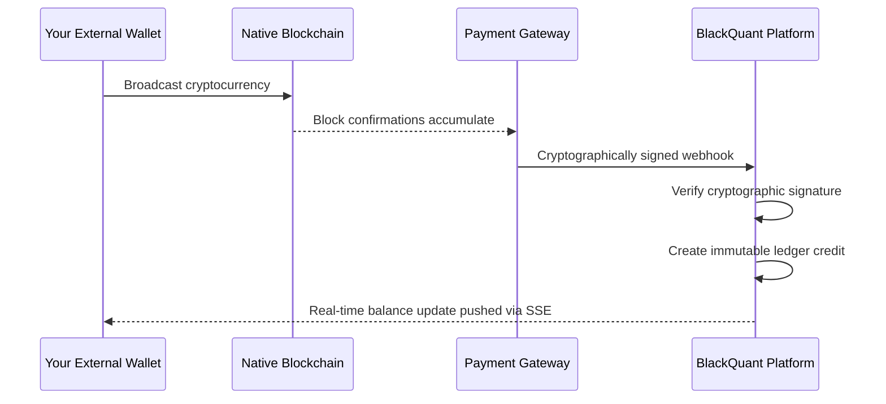

Go to **Apps → Fund Account**.

<Danger>
**Read this before broadcasting any transaction.**

Every asset below is assigned to **one fixed decentralized network**. Network assignment is fixed to protect you against cross-chain routing mistakes, which are the leading cause of permanent loss in cryptocurrency transfers.

Send USDT over TRC-20 to the generated TRC-20 address. An address generated for one network cannot receive assets transferred over another.
</Danger>

## Supported assets and networks

| Asset | Native Network | Confirmations Required | Initial Detection |
| --- | --- | --- | --- |
| BTC | Bitcoin | 6 blocks | ~10 minutes |
| ETH | ERC-20 (Ethereum) | 12 blocks | ~1 minute |
| USDT | TRC-20 (Tron) | 20 blocks | ~1 minute |
| BNB | BEP-20 (BNB Smart Chain) | 15 blocks | ~5 seconds |
| SOL | Solana | 32 blocks | ~1 second |
| XRP | XRP Ledger | 1 block | ~5 seconds |
| ADA | Cardano | 15 blocks | ~20 seconds |
| DOT | Polkadot | 2 blocks | ~6 seconds |

"Initial Detection" represents approximately how quickly the transaction appears in the mempool. Full ledger crediting occurs once the required block confirmations are fulfilled.

## Step-by-step deposit instructions

1. **Select an asset**: The network is immediately fixed and displayed.
2. **Review the minimum threshold**: Transfers below this threshold cannot be processed due to blockchain gas fees.
3. **Copy the recipient address**: Use the copy button rather than manual transcription.
4. **Verify destination memo/tag**: If a memo or tag is displayed, include it in your wallet transfer. Transfers missing required tags cannot be attributed automatically.
5. **Broadcast from your wallet** using the designated network.
6. **Track confirmation progress**: Status updates stream in real time via Server-Sent Events without requiring page refreshes.

## Deposit state lifecycle

| State | Definition | Action Required |
| --- | --- | --- |
| `WAITING` | Address provisioned, awaiting network broadcast | Broadcast transaction from your wallet |
| `CONFIRMING` | Detected on-chain; confirmations accumulating | Allow network validators to finalize blocks |
| `CONFIRMED` | Threshold satisfied; credited to account balance | None; funds are available immediately |
| `PARTIALLY_PAID` | Received amount falls short of minimum invoice | Contact [Help Desk](/platform/knowledge-and-help) with transaction hash |
| `FAILED` | Transaction failed or dropped from mempool | Review your wallet; funds typically remain unspent |
| `EXPIRED` | Address session elapsed prior to broadcast | Provision a new address; do not send to expired addresses |

## Real-time ledger crediting

Once network confirmations are complete, the payment gateway dispatches a cryptographically signed IPN webhook. The platform validates the signature before updating account balances.

Crediting records an immutable **ledger entry**, ensuring every balance update is backed by verifiable historical provenance under [Treasury](/platform/treasury).

## Essential precautions

* **Network accuracy**: Ensure your wallet network matches the address network exactly.
* **Destination tags**: Always provide memos or destination tags where required.
* **Minimum amounts**: Ensure transfer values exceed stated network minimums.
* **Session validity**: Generate a fresh deposit address for new funding sessions.

## Next step

* [Choose a signal plan](/getting-started/choose-a-signal-plan): Activate subscription tiers and unlock Smart Executors.
