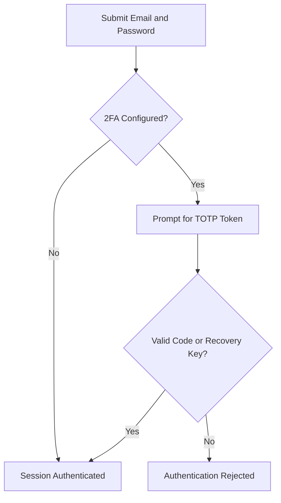

We strongly recommend enabling two-factor authentication before depositing digital assets. Spending two minutes now prevents critical security exposure later.

## Enable two-factor authentication (2FA)

Navigate to **Personal → 2FA / Auth Guard** in the dashboard sidebar.

### 1. Begin enrollment

The platform provisions a unique secret displayed as a QR code with a manual text fallback. Secrets are encrypted at rest using envelope encryption: they are never persisted in plain text.

### 2. Scan with an authenticator app

Compatible with all standard TOTP applications: 1Password, Bitwarden, Google Authenticator, Authy, Aegis, or Raivo.

### 3. Verify enrollment with an active code

Enter the six-digit code displayed in your authenticator app. Enrollment only finalizes after a valid code is verified: if verification fails, no settings are modified and you can retry safely.

<Info>
Verification accommodates **one step of clock skew** (±30 seconds). If codes are repeatedly rejected, confirm that your device clock has automatic network time synchronization enabled.
</Info>

### 4. Secure your single-use recovery codes

You are provided with **ten single-use recovery codes**. Each recovery code allows one emergency authentication if your mobile device is inaccessible.

<Danger>
Recovery codes are displayed only once upon initial setup. Store them in a secure, offline environment separated from your primary device and master password.
</Danger>

Redeeming a recovery code invalidates that specific token atomically within the database query, preventing concurrent replay attacks.

## Sign-in verification workflow

Once enabled, every login requires a valid 2FA code. Authentication checks are enforced at the API middleware level, ensuring direct API requests cannot bypass secondary verification:

## Regenerating recovery codes

Navigate to **2FA / Auth Guard → Regenerate recovery codes** to provision ten fresh recovery codes and automatically invalidate previous ones. Do this if you have consumed several backup codes or suspect they may have been exposed.

## Disabling two-factor authentication

Disabling 2FA requires entering an active TOTP code first, preventing an attacker with compromised passwords from turning off authentication safeguards. Disabling 2FA automatically revokes all existing recovery codes.

## Session duration options

| Checkbox Selection | Session Duration |
| --- | --- |
| "Remember me for 30 days" checked | 30 days |
| Unchecked | 24 hours |

Session tokens enforce expiration timestamps within the JWT itself. On shared or public workstations, leave the box unchecked and sign out explicitly.

## Essential security checklist

* [x] Two-factor authentication (TOTP) enabled
* [x] Recovery codes stored offline in a secure location
* [x] Unique master password not shared with any exchange or service
* [x] "Remember me" unchecked on public or shared workstations

## Next step

* [Verify your identity](/verify-your-identity): Required prior to processing capital withdrawals.
