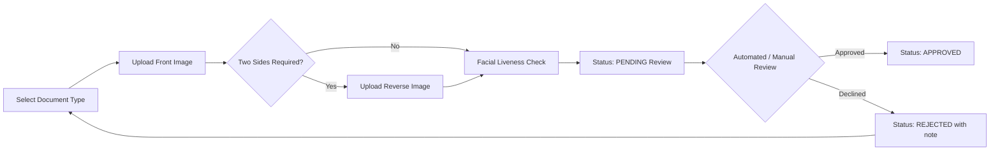

Identity verification is required before you can withdraw capital. Depositing assets, subscribing to plans, and running Smart Executors operate without upfront verification.

Navigate to **Personal → Verification**.

## Accepted identity documents

| Document | Sides Required | Notes |
| --- | --- | --- |
| Passport | 1 page | Photo / data page only |
| Driver's License | 2 sides | Front and reverse |
| National Identity Card | 2 sides | Front and reverse |

## Document capture requirements

All submissions must meet standard image quality criteria:

* Document must be **valid and unexpired**
* **All four edges and corners** must be fully visible
* Text, MRZ codes, and photographs must be **sharp and legible**
* **No heavy reflections, glare, shadows, or digital alterations**

### Image format limits

| Parameter | Specification |
| --- | --- |
| Supported Formats | JPEG, PNG, WebP |
| Maximum File Size | 8 MB per image |

Standard mobile camera photos easily meet these technical specifications.

## Facial liveness verification

Following document upload, you complete a quick **liveness capture**: a real-time selfie verified via algorithmic liveness detection to ensure the submitter matches the photo document.

## Review workflow

## Verification statuses

| Status | Definition |
| --- | --- |
| `PENDING` | Received and undergoing automated review |
| `APPROVED` | Identity verified; capital withdrawals unlocked |
| `REJECTED` | Submission declined; explanation note provided |

Declined submissions include specific guidance so you can retake the photo with improved lighting or sharper framing and re-submit immediately.

## Data storage and privacy safeguards

* Submitted images are stored in encrypted private object storage vaults, isolated from public web directories.
* Verification data is strictly utilized for compliance and is never shared with third parties.
* You can export all account records at any time via **My Profile → Export account data**.
* Account deletion under **My Profile** cascades to purge all stored identity documents.

## Next step

* [Fund your account](/getting-started/fund-your-account): Deposit assets and fund your balance.
