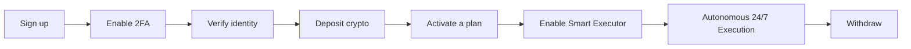

BlackQuant is **non-custodial execution infrastructure for on-chain digital asset markets**, operated by **BlackQuant Labs LLC**, a Delaware limited liability company (File Number: 10814234). It watches liquidity across major blockchain networks, fires signals when empirical edges appear, and settles executions on-chain where you can verify every transaction independently.

Non-custodial is the load-bearing foundation. BlackQuant is granted permission via scoped session keys (ERC-4337) to execute specific routing parameters and vault allocations on your behalf, and is never granted permission to withdraw your capital. Your private keys stay yours for the entire lifetime of your account.

<Info>
**New here?** The fastest path from initial setup to a running account is five straightforward steps: [Create an account](/getting-started/create-an-account) → [Secure your account](/getting-started/secure-your-account) → [Verify your identity](/getting-started/verify-your-identity) → [Fund your account](/getting-started/fund-your-account) → [Choose a signal plan](/getting-started/choose-a-signal-plan).
</Info>

## Where to go

| Section | What is in it |
| --- | --- |
| [**Introduction**](/introduction/what-blackquant-is) | What the platform actually does, corporate entity details, vocabulary, and audience. |
| [**Getting started**](/getting-started/create-an-account) | Account creation through to a funded account with an active plan. |
| [**Using the platform**](/platform/control-center) | Every dashboard screen and execution interface, one page each. |
| [**Billing**](/billing/plans-and-pricing) | Subscription plans, permanent add-ons, and crypto checkout flows. |
| [**Security & Corporate**](/security/corporate-and-regulatory) | Corporate entity records, regulatory positioning, custody model, 2FA, recovery, and audits. |
| [**Developers**](/developers/architecture) | Technical stack, production operational status, API endpoints, and webhooks. |

## The short version

Each step corresponds to a dedicated guide in [Getting started](/getting-started/create-an-account).

## What BlackQuant never does

These are structural guarantees, not policy promises: they follow directly from our system architecture, as detailed in [The custody model](/security/custody-model):

* It never holds your external wallet private keys.
* It never has withdrawal permission on your assets.
* It never co-mingles trading capital with operational platform accounts.
* It never places an order from the signal engine API. The engine measures and publishes; it cannot move money. See [Signal Engine](/platform/signal-engine).
* It never pays referral commission on a deposit, only on a purchase. See [Referral Hub](/platform/referral-hub) for why that distinction matters.

## Status and transparency

* **Corporate Entity**: Legally registered in Delaware, USA (File Number: 10814234). See [Corporate and regulatory positioning](/security/corporate-and-regulatory).
* **Audits**: Full third-party security assessment reports from OpenZeppelin and Trail of Bits are published at [Audit reports](/security/audit-reports) and [`https://blackquantlabs.com/audits`](https://blackquantlabs.com/audits).
* **Uptime & Health**: Real-time status monitoring is available at `/api/health`.
* **Contracts**: On-chain smart contract foundations are open source at [github.com/Blackquant-labs/blackquant-contract](https://github.com/Blackquant-labs/blackquant-contract).

<Warning>
BlackQuant is algorithmic execution infrastructure, not investment advice. Nothing in this documentation is a recommendation to buy or sell any asset, and no historical observation guarantees future performance. Read [Reading the numbers honestly](/platform/signal-engine#reading-the-numbers-honestly) before evaluating strategy statistics.
</Warning>
