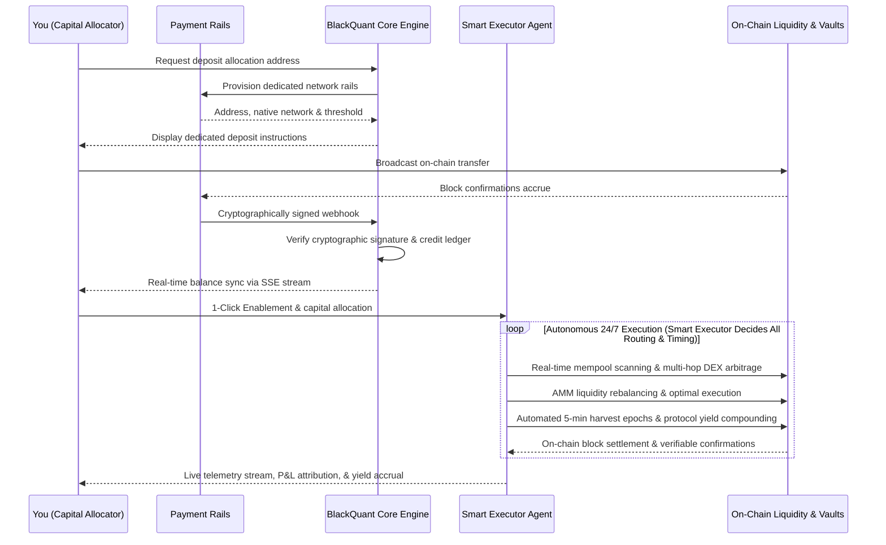

BlackQuant is institutional-grade execution infrastructure built to systematically capture decentralized market inefficiencies. By replacing manual discretion with autonomous **Smart Executors**, the platform eliminates latency disadvantages, emotional friction, and operational overhead. 

The architecture operates on a foundational non-custodial principle: **the user does not manually time markets, execute orders, or manage open positions.** Instead, users establish predefined risk boundaries, allocate capital, and activate an autonomous Smart Executor. The executor's quantitative models handle market telemetry, multi-factor trade ranking, sub-second routing, position lifecycle management, and compounding 24/7.

## The full path

## Step by step operational lifecycle

### 1. Dedicated capital onboarding

Capital onboarding is streamlined through dedicated payment rails. On [Fund your account](/getting-started/fund-your-account), the system provisions a dedicated deposit address locked to the asset's native blockchain network. Network locking is enforced at the protocol layer to eliminate cross-chain transfer errors.

<Danger>
**Cross-chain routing integrity is permanent.** BlackQuant provisions addresses locked to each asset's native blockchain rather than generic multi-chain drop-downs. This architectural constraint protects against cross-chain routing errors. Always transfer assets across the exact network displayed.
</Danger>

### 2. Deterministic block confirmation schedule

Transactions transition deterministically through verifiable on-chain states: `WAITING` → `CONFIRMING` → `CONFIRMED`. Block confirmation thresholds are calibrated to the underlying consensus model of each network, from 1 block on the XRP Ledger to 32 confirmations on Solana, ensuring complete finality before ledger crediting. See [Fund your account](/getting-started/fund-your-account#supported-assets).

### 3. Cryptographically verified ledger crediting

Incoming transfers trigger an ed25519-signed callback from our payment gateway infrastructure. BlackQuant validates the cryptographic signature prior to executing ledger state changes; invalid or tampered webhooks are rejected at the edge. See [Webhooks](/developers/webhooks).

Every credit creates an immutable **ledger entry**. Account balances are derived mathematically as the sum of verifiable ledger events rather than mutable database flags, providing a complete historical audit trail.

### 4. Entitlement activation and strategy tier access

Subscribing to a [signal plan](/billing/plans-and-pricing) provisions dedicated execution runtimes. Term options span 30-day or 365-day access, while permanent [add-ons](/billing/add-ons) expand concurrent execution capacity and risk controls without renewal overhead.

Activating a tier unlocks the autonomous Smart Executor runtimes calibrated to your selected risk profile and capital allocation.

### 5. Transparent multi-tier affiliate settlement

Platform growth is incentivized through transparent, on-chain verifiable affiliate distribution: **5% to direct referrers (Tier 1)** and **2% to second-generation referrers (Tier 2)**. 

<Info>
Commissions are calculated strictly on verified platform subscription revenue, never on customer principal deposits. Customer trading capital remains non-custodial and 100% eligible for withdrawal at all times. See [Referral Hub](/platform/referral-hub).
</Info>

### 6. Autonomous Smart Executor execution

The core technological engine of BlackQuant is the **Smart Executor**: an autonomous execution bot that operates directly against on-chain liquidity pools and smart contract vaults.

**The user does not pick trading pairs, manage order books, or decide entry and exit timings.** Once enabled, the Smart Executor operates 100% autonomously around the clock across two specialized execution frameworks:

* **Active Arbitrage Suite (Liquidity Optimizer & MEV Arbitrage)**:
  * **Real-Time DEX Telemetry**: Monitors decentralized liquidity pools and mempools across EVM networks (Ethereum Mainnet, Arbitrum, Base) and Solana DEX pools.
  * **Systematic Multi-Hop Routing**: Captures cross-venue pricing discrepancies and optimal routing pathways through sub-second execution logic.
  * **Range Rebalancing**: Autonomously adjusts concentrated liquidity positions on live market prices to maximize fee generation while mitigating impermanent loss.
  * **Senior MEV Arbitrage**: High-frequency algorithmic router engineered for institutional desks, identifying fleeting atomic arbitrage opportunities and executing priority transactions.
* **Automated Protocol Yield Suite (Yield Farmer)**:
  * **Audited Multi-Vault Staking**: Deploys capital into non-custodial, institutional-grade DeFi vaults (including Aave v3 Prime, Kamino Automated Yield, Marinade, and Curve).
  * **5-Minute Compounding Epochs**: Executes 288 automated harvest cycles every 24 hours. Harvested yields are systematically compounded back into principal or routed to daily cash balances.
  * **Cryptographic Proof of Reserves**: Assets remain verified on-chain in smart contracts audited by OpenZeppelin and Trail of Bits.
* **Autonomous Risk Boundaries & Fail-Safe Protection**:
  * Executors operate via delegated session keys (ERC-4337) with strict mathematical constraints on maximum slippage, position sizing caps, and stop-loss floors.
  * Automated circuit breakers immediately halt order routing if out-of-band market conditions appear (such as abnormal pool slippage or sudden liquidity dry-ups), requiring explicit one-click authorization before resuming.

All positions, allocations, and compounding epochs are tracked in [Positions](/platform/positions) and verifiable on block explorers.

### 7. Non-custodial capital withdrawal

Trading capital remains under your sovereign control. When you choose to rebalance or exit, you can stop a Smart Executor with a single click to return capital to your available balance. Withdrawal requests are submitted through [Withdrawals](/platform/withdrawals) and dispatched on-chain following standard automated security checks.

## Real-time telemetry and data streams

| Operational Stream | Protocol / Architecture | Institutional Function |
| --- | --- | --- |
| Deposit Confirmations | Server-Sent Events (`/api/deposit/stream`) | Microsecond block confirmation tracking without client polling |
| Signal Telemetry Engine | Server-Sent Events (`/api/signal-engine/stream`) | Live liquidity telemetry, order book depth, and 90% credible intervals |
| Protocol Yield Daemon | Automated epoch timer & WebSocket sync | 5-minute harvest cycle execution and real-time yield compounding |
| Dynamic Account Ledger | Reactive event stream | Cryptographically derived balance state synchronized across nodes |
| Smart Contract Settlement | On-chain query cache | Real-time synchronization with EVM and Solana block states |

## Next steps

* [Key concepts](/introduction/key-concepts): Institutional vocabulary and execution mechanics.
* [Create an account](/getting-started/create-an-account): Account onboarding and initial security setup.
* [The custody model](/security/custody-model): Delegated key architecture, non-custodial boundaries, and smart contract security.
