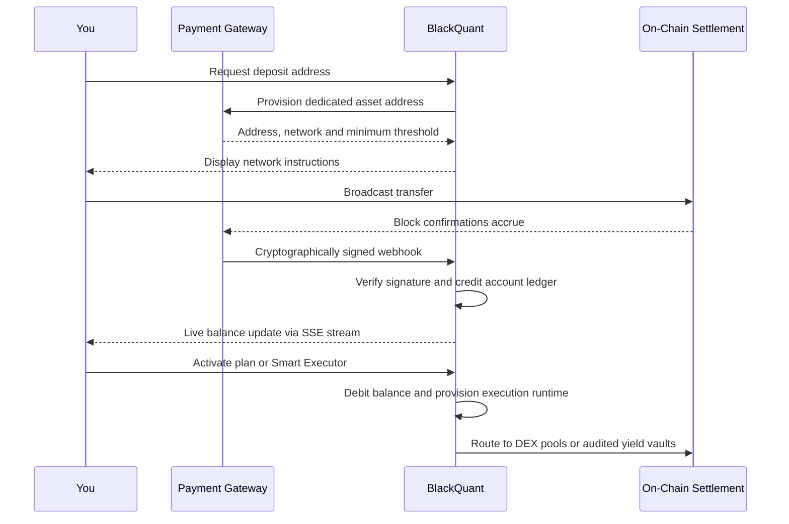

This guide traces capital and execution through each stage of the BlackQuant platform, connecting each step to its detailed technical reference.

## The full path

## Step by step

### 1. Account funding arrives

You select an asset on [Fund your account](/getting-started/fund-your-account). The platform provisions a dedicated deposit address for that asset on a fixed decentralized network. The network assignment is fixed to protect against cross-chain transfer errors.

<Danger>
**Sending an asset over the wrong network can lead to permanent loss.** BlackQuant locks each deposit asset to its native network rather than offering a generic dropdown, specifically to prevent misrouted funds. Always send funds on the exact network displayed.
</Danger>

### 2. Block confirmations accrue

Each asset requires a specific number of on-chain confirmations before crediting, ranging from 1 block on the XRP Ledger to 32 confirmations on Solana. The complete schedule is listed in [Fund your account](/getting-started/fund-your-account#supported-assets).

Your transaction transitions through standard states: `WAITING` → `CONFIRMING` → `CONFIRMED`. Handling for exceptions like `PARTIALLY_PAID` or `EXPIRED` is documented in [Troubleshooting](/resources/troubleshooting#deposit-states).

### 3. Signed webhook verification and ledger crediting

The payment gateway sends a cryptographically signed callback. BlackQuant validates the cryptographic signature before altering account records; unsigned or invalid webhooks are rejected immediately. See [Webhooks](/developers/webhooks).

Crediting creates an immutable **ledger entry**. Your account balance is derived directly from this ledger, providing a complete historical audit trail for every credit and debit.

### 4. Subscription and entitlement activation

A [signal plan](/billing/plans-and-pricing) provides a structured term: 30 days for monthly subscriptions or 365 days for annual billing. Optional [add-ons](/billing/add-ons) carry permanent entitlements with no renewal requirement.

Pricing is looked up server-side from immutable item identifiers, ensuring pricing integrity cannot be modified in the browser.

### 5. Multi-tier referral distribution

When an account was referred by an existing member, commissions are distributed at the moment a subscription or add-on is purchased: **5% to the direct referrer (Tier 1)** and **2% to their upstream referrer (Tier 2)**.

<Info>
Commissions are awarded strictly on verified platform purchases, never on account deposits. Deposits represent personal capital eligible for withdrawal, whereas purchases represent platform revenue. Learn more in [Referral Hub](/platform/referral-hub).
</Info>

### 6. Strategy execution and on-chain settlement

Once subscribed, you can configure and run **Smart Executors** across two execution suites:

* **Active Arbitrage Suite**: Automated execution bots (Liquidity Optimizer and MEV Arbitrage) monitor decentralized liquidity pools, placing low-latency rebalancing transactions to capture price discrepancies between order books and AMMs.
* **Automated Protocol Yield Suite**: The Yield Farmer bot allocates capital across audited decentralized vaults (including Aave, Kamino, Marinade, and Curve). It executes auto-harvesting and compounding cycles on fixed 5-minute epochs (288 epochs daily), allowing you to reinvest yield into principal or receive daily payouts with non-custodial cryptographic reserve verification.

All positions, allocations, and compounding epochs are tracked in [Positions](/platform/positions) and verifiable on block explorers.

### 7. Capital withdrawal

When you wish to withdraw funds, submit a payout request in [Withdrawals](/platform/withdrawals). Requests undergo standard security and verification checks before on-chain dispatch.

## Real-time platform data streams

| Surface | Update mechanism | Notes |
| --- | --- | --- |
| Deposit confirmations | Server-Sent Events (`/api/deposit/stream`) | Real-time block confirmation status without manual refresh |
| Signal engine feeds | Server-Sent Events (`/api/signal-engine/stream`) | Live strategy telemetry and calibration data |
| Yield Farmer compounding | Live countdown timer & background polling | 5-minute harvest epochs with real-time accrual tracking |
| Account balances | Real-time event stream and navigation sync | Derived directly from validated ledger entries |
| Position tracking | Real-time query cache | Live synchronization with execution smart contracts |

## Next

* [Key concepts](/key-concepts): Terminology and system mechanics.
* [Create an account](/getting-started/create-an-account): Set up your access credentials.
