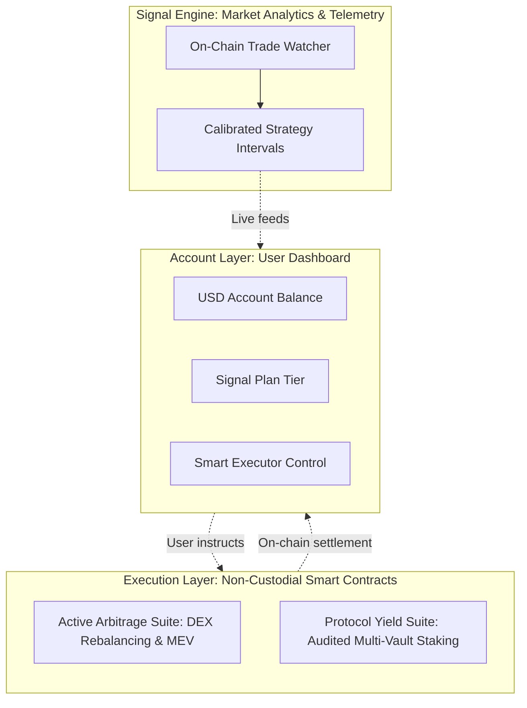

BlackQuant is algorithmic execution infrastructure designed for decentralized digital asset markets, operated by **BlackQuant Labs LLC**, a Delaware limited liability company (File Number: 10814234).

The platform delivers three distinct components that operate together while remaining structurally separated:

## The three parts

### 1. The signal engine

A real-time monitoring engine that observes on-chain liquidity feeds, detects market inefficiencies, and systematically measures what those signals yield afterwards.

The engine publishes win rates and performance metrics only after positions resolve. Prior to resolution, it publishes `null` rather than zero. An unmeasured outcome is fundamentally different from a failing one, and the platform never collapses them into the same number.

Every performance metric published by the engine includes a **90% credible interval**, giving you clear mathematical bounds on statistical confidence rather than misleading point estimates.

<Info>
**The engine cannot place orders.** Nothing reachable from the signal engine API can move funds. It is strictly a measurement and analytical intelligence service, separated by architecture from execution.
</Info>

### 2. The dual-engine execution layer

The non-custodial smart contracts and automated execution runtimes that carry out quantitative strategies. The open-source smart contract foundation is accessible at [github.com/Blackquant-labs/blackquant-contract](https://github.com/Blackquant-labs/blackquant-contract).

Execution operates across two specialized strategy suites:

* **Active Arbitrage Suite (Liquidity Optimizer & MEV Arbitrage)**: Built for dynamic market conditions. It continuously tracks decentralized exchange order books and automated market maker pools to capture pricing discrepancies and rebalance liquidity ranges. MEV Arbitrage represents our senior high-frequency trading (HFT) execution strategy.
* **Automated Protocol Yield Suite (Yield Farmer)**: Built for steady, non-custodial capital accumulation. It allocates assets across vetted decentralized finance protocols (including Aave, Kamino, Marinade, and Curve) with automated 5-minute compounding epochs and cryptographic proof of reserves.

All execution contracts are non-custodial: they are granted permission to execute designated routes and deposit into vetted protocol vaults, but have no code path to withdraw user capital to unauthorized destinations. Core contracts and vault routing systems have been audited by OpenZeppelin and Trail of Bits. See [The custody model](/security/custody-model) and [Audit reports](/security/audit-reports).

### 3. The account layer

The secure dashboard interface where you manage your USD balance, funding deposits, signal subscription tiers, Smart Executors, referral rewards, and security credentials.

The dashed lines represent essential security boundaries. The signal engine publishes intelligence to the dashboard; it cannot trigger smart contracts on its own. You maintain full authority over execution.

## Commercial positioning and strategy tiers

BlackQuant is built to accommodate varying participant profiles and risk objectives:

* **Beginners & Passive Participants**: The Automated Protocol Yield Suite (Yield Farmer) prioritizes capital preservation, over-collateralized lending markets, and automated 5-minute auto-compounding without fast-paced manual trade execution.
* **Active Quantitative Traders**: The Active Arbitrage Suite (Liquidity Optimizer) provides automated liquidity range rebalancing across dynamic AMM pools.
* **Institutional & Professional Teams**: MEV Arbitrage leverages high-frequency mempool scanning and optimal multi-hop routing to capture fleeting cross-market price discrepancies.

## What it is not

**It is not a custodial exchange.** BlackQuant does not hold your assets in an opaque centralized wallet. Your USD dashboard balance is a transparent ledger for funding subscriptions and allocations.

**It is not a discretionary hedge fund.** Nobody at BlackQuant makes subjective investment decisions on your behalf. Strategies operate strictly according to algorithmic rules and parameters you define.

**It is not an unverified signal channel.** Every strategy metric is anchored by historical resolution, statistical credible intervals, and verifiable on-chain settlement.

## Realistic infrastructure principles

* **Historical data informs probability, not certainty.** Every published performance figure reflects historical observations. Statistical intervals quantify sampling variance, not future market regimes.
* **Audits confirm contract security within tested scopes.** Security audits from OpenZeppelin and Trail of Bits verify contract logic and reserve mechanics; they do not eliminate broader market risk.
* **Infrastructure edge relies on reliable engineering.** Low-latency decentralized exchange connectivity and automated 5-minute compounding epochs provide consistent execution, free of exaggerated claims or fictional speeds.

## Next

* [Corporate and regulatory positioning](/security/corporate-and-regulatory): Legal registration in Delaware and regulatory positioning.
* [How it works](/how-it-works): The end-to-end operational flow, step by step.
* [Key concepts](/key-concepts): Essential vocabulary and definitions.
