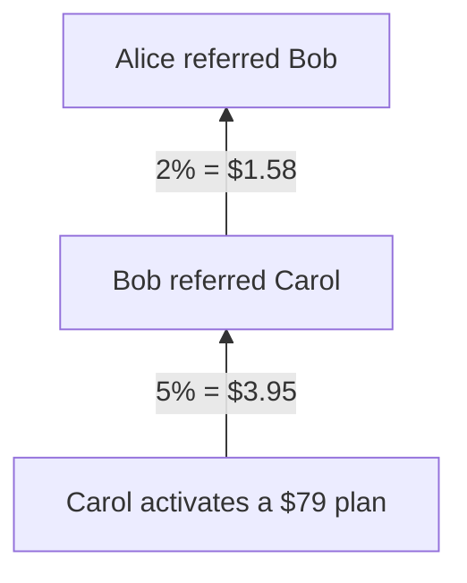
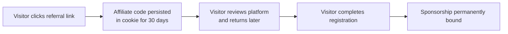

**Apps → Referral Hub.** Manage your affiliate link, track downstream team members, and monitor earned commissions.

## The commission structure

Two tiers, calculated in **basis points** of the net purchase price:

| Tier | Beneficiary | Commission Rate |
| --- | --- | --- |
| Tier 1 | Direct referring sponsor | **5%** (500 basis points) |
| Tier 2 | Second-tier upstream sponsor | **2%** (200 basis points) |

Affiliate commissions are funded directly from platform margins, never deducted from what the purchaser pays.

<Info>
Rates are calculated in integer basis points rather than floating-point decimals to guarantee exact decimal accounting (for example, 5% of $29 equals exactly $1.45). All ledger amounts adhere to fixed-precision decimal arithmetic.
</Info>

## Commission is paid on purchases, never on deposits

This is an essential security principle of the BlackQuant affiliate structure:

<Danger>
**Deposits remain personal user capital.** Account holders can withdraw deposited funds at any time. Awarding affiliate commissions on deposits would introduce financial instability and create artificial round-tripping risks.

**Purchases represent earned platform revenue.** Only verified subscription plan activations and permanent add-on purchases generate affiliate payouts.
</Danger>

For example: an account that deposits $100,000 without activating a plan generates zero commission. An account that activates a $79 Growth plan generates $3.95 for their Tier 1 sponsor and $1.58 for their Tier 2 sponsor.

## Your affiliate referral code

A unique **eight-character alphanumeric code** generated from a disambiguated character set (omitting ambiguous characters like `0`, `o`, `1`, `l`, and `i`).

Your shareable referral link format is: `/ref/<your-code>`.

## Multi-touch attribution model

A **30-day cookie window** ensures attribution is preserved even if a prospective member explores the platform for several weeks before registering.

Once established at registration, the affiliate sponsorship is permanent.

## Referral Hub features

| Section | Description |
| --- | --- |
| Affiliate Link | Your personal code and direct shareable link with one-click copy |
| Performance Summary | Total team member count and cumulative USD earnings |
| Downstream Directory | Comprehensive member list with active status filtering |
| Direct Share Shortcuts | One-click share links for Telegram, X, and messaging apps |

## Payout crediting and ledger records

Earned commissions are credited immediately to your **USD account balance** as an immutable ledger transaction at the moment a downstream purchase resolves. These funds can be utilized for plan upgrades, staked in Smart Executors, or withdrawn to external crypto wallets.

## Referral notification controls

To avoid high message volume for active affiliates, referral alerts default to off. You can enable them under **Personal → My Profile**.

## Program guidelines

* Self-referrals and circular referral trees are prohibited by programmatic constraints.
* Affiliate bindings are permanent upon account creation.
* Commissions are calculated on the full verified purchase price.
* Both Tier 1 and Tier 2 commissions are disbursed concurrently on qualifying purchases.

## Related documentation

* [Plans and pricing](/billing/plans-and-pricing): Subscription options your team can activate.
* [Treasury](/platform/treasury): Real-time balance and ledger credit tracking.
