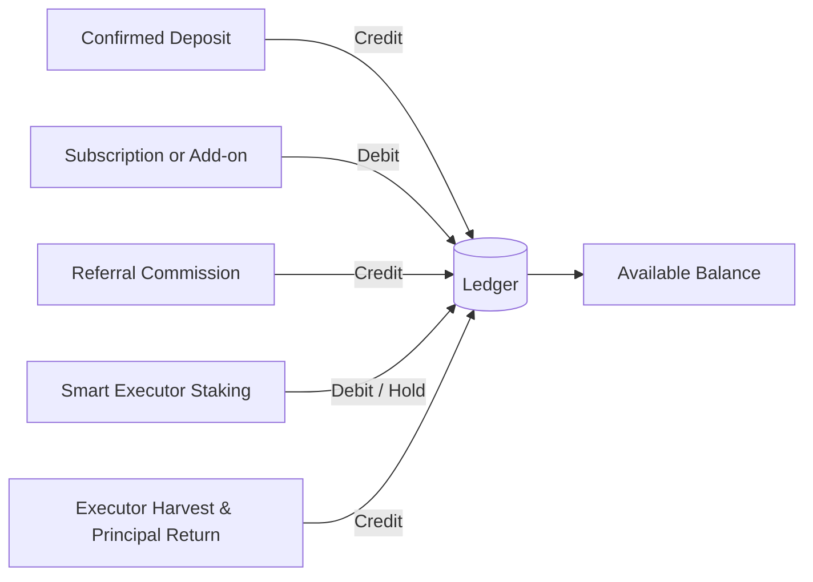

**Apps → Treasury.** Complete visibility into your account balance and the underlying ledger that calculates it.

## Balance is derived from ledger transactions

Your balance is not a standalone counter that gets incremented arbitrarily. It is the real-time sum of your **ledger entries**: immutable transaction rows, each recording a numerical amount, a `kind` category describing the transaction event, and a reference identifier pointing to the source event.

This guarantees complete financial auditability: you can verify the provenance of every cent.

## What is on the screen

| Section | Description |
| --- | --- |
| Headline Balances | Current available balance, held staking capital, and 30-day net movement |
| Balance Trajectory | Chronological equity chart plotting balance over time |
| Asset Allocation | Breakdown of available liquidity versus active Smart Executor allocations |
| Ledger Ledger Feed | Every individual ledger entry, sorted newest first with transaction links |

## Understanding ledger entry types

| Movement Type | Ledger Direction | Description |
| --- | --- | --- |
| Deposit Credited | Credit (+) | Digital asset deposit confirmed on-chain |
| Subscription / Add-on Purchase | Debit (−) | Plan tier activation or permanent add-on purchase |
| Referral Commission Earned | Credit (+) | Affiliate reward from downstream subscription purchase |
| Smart Executor Allocation | Debit / Hold (−) | Staking capital reserved for active Smart Executor run |
| Smart Executor Harvest & Settlement | Credit (+) | Return of principal plus accumulated net yield or trading gains |
| Withdrawal Dispatched | Debit (−) | Authorized payout sent to external wallet |

Amounts are calculated and stored in fixed-precision decimals rather than floating-point numbers, preventing rounding errors across micro-yield accruals and commission calculations.

## Independent blockchain reconciliation

Every deposit ledger entry records the underlying on-chain transaction hash. You can paste this hash into block explorers to verify the transaction independently on the native network.

<Info>
Verification is an intentional design pillar. Every credit in your ledger originates from verifiable on-chain actions.
</Info>

## Common questions

**My deposit reached network confirmations, but my balance hasn't updated.**
Ledger crediting occurs upon receipt and verification of the cryptographically signed gateway webhook, which can take a few seconds after final block confirmation. See [Troubleshooting](/resources/troubleshooting#deposit-states).

**I received a commission credit unexpectedly.**
An account linked to your referral code purchased a subscription plan or add-on. Tier 1 awards 5% and Tier 2 awards 2%. See [Referral Hub](/referral-hub).

**How do I withdraw my balance to an external crypto wallet?**
Navigate to [Withdrawals](/withdrawals) after completing your one-time identity verification.

## Related documentation

* [Fund your account](/getting-started/fund-your-account)
* [Withdrawals](/withdrawals)
* [Plans and pricing](/billing/plans-and-pricing)
