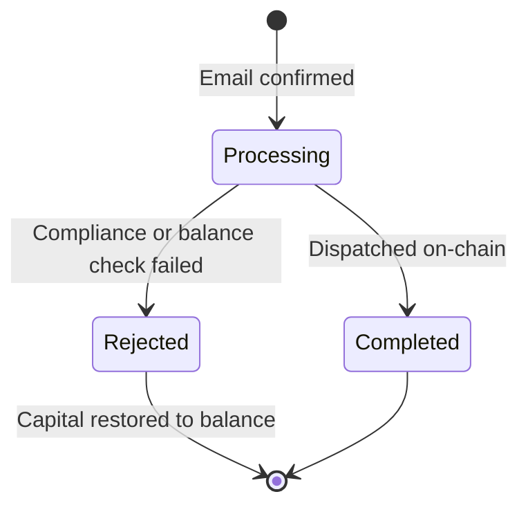

**Apps → Withdrawals.** Manage payout requests and review historical withdrawal disbursements.

<Warning>
**Identity verification is required before initiating a withdrawal.** If you have not completed verification yet, please complete it first via [Verify your identity](/getting-started/verify-your-identity). Completing verification early ensures swift processing when you decide to withdraw funds.
</Warning>

## Supported payout methods & settlement velocity

Withdrawal requests typically clear between **30 minutes and 24 hours**, depending on liquidity pool clearing epochs, risk boundary checks, and target blockchain network finality:

| Method | Settlement & Clearance Window | Post-Dispatch Finality |
| --- | --- | --- |
| USDT (TRC-20) | 30 minutes to 24 hours (clearing dependent) | ~10 minutes (TRON block confirmation) |
| USDT (BEP-20) | 30 minutes to 24 hours (clearing dependent) | ~5 minutes (BNB Chain block confirmation) |
| Bank Wire (Institutional) | 1 to 3 business days | Standard SWIFT/SEPA clearing rails |

<Info>
**Why does capital settlement take between 30 minutes and 24 hours?**
Trading capital in BlackQuant is actively routed across decentralized liquidity pools, automated market makers, and institutional lending vaults. When a withdrawal request is submitted:
1. **Orderly Liquidity Unwinding**: Smart Executors unwind active pool allocations during discrete 5-minute harvest epochs to prevent price impact, slippage, and premature vault exit fees.
2. **Multi-Tier Security & Risk Clearance**: Every withdrawal undergoes automated risk reconciliation, cryptographic authorization via email and 2FA, and proof-of-reserve validation.
3. **Automated On-Chain Dispatch**: Once security and clearing gates verify the transaction, capital is broadcast directly on-chain with an immutable transaction hash for instant block explorer verification.
</Info>

<Danger>
**Network selection must match your recipient address.** A USDT withdrawal designated for a TRC-20 address must be broadcast over the TRC-20 network. Submitting a BEP-20 address while choosing TRC-20 routes funds to an incompatible address on that chain, resulting in irrecoverable loss.

Copy recipient addresses directly from your external wallet and verify that the selected network matches exactly.
</Danger>

## How to submit a withdrawal request

1. Select your preferred **payout method** (USDT on TRC-20, BEP-20, or bank wire).
2. Enter your desired **amount** (cannot exceed your unencumbered available balance).
3. Provide the verified destination: external wallet address or recipient banking coordinates.
4. Authorize the submission via the email confirmation link dispatched to your registered address.

## Request status lifecycle

| Status | Definition |
| --- | --- |
| **Processing** | Request verified via email authorization and undergoing compliance check |
| **Completed** | Payout dispatched on-chain with verifiable transaction hash |
| **Rejected** | Request declined; explanation detailed directly in the transaction row |

A declined request immediately restores the requested funds to your available account balance.

## Transaction history and reconciliation

The withdrawals screen maintains a comprehensive log featuring a unique tracking reference (`WD-xxxx`), creation timestamp, requested amount, payout method, masked destination, and current status. Filter records by **All**, **Completed**, or **Pending**.

## Common rejection reasons and resolutions

| Issue | Resolution |
| --- | --- |
| Identity verification pending | Complete [Verify your identity](/getting-started/verify-your-identity) |
| Incompatible network format | Ensure your address matches the selected blockchain standard |
| Amount exceeds available balance | Check [Treasury](/platform/treasury) for funds locked in active Smart Executors |
| Bank account mismatch | Bank transfers must match the legal name verified during KYC |

## Operational recommendation

We recommend executing a small test withdrawal ($50 minimum) upon initial onboarding. Testing the full cycle confirms your recipient wallet settings and identity credentials before moving substantial capital.

## Related documentation

* [Treasury](/platform/treasury): Account balances and ledger tracking.
* [Verify your identity](/getting-started/verify-your-identity): One-time verification prerequisites.
