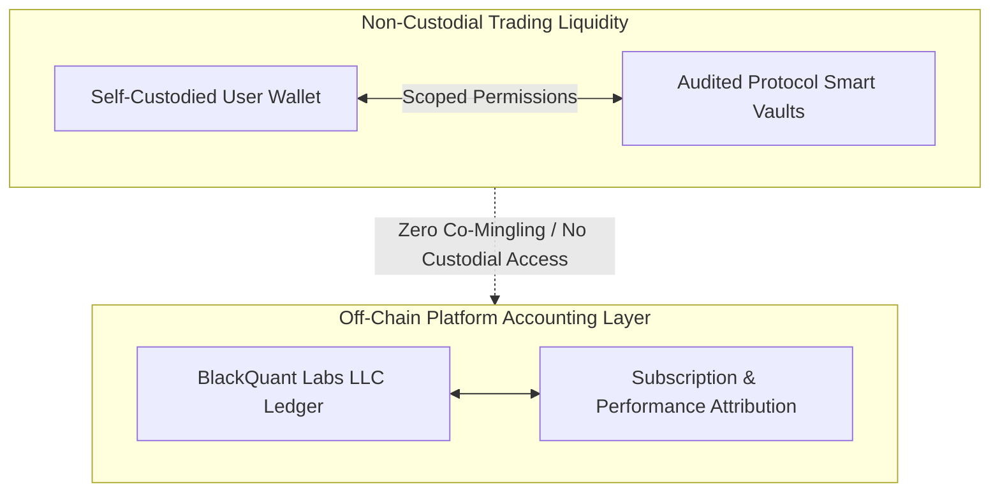

Transparency and institutional readiness are fundamental principles of the BlackQuant platform. This page details our corporate registration, legal entity structure, governance, official Delaware filing documents, and regulatory positioning across global jurisdictions.

## Corporate registration

BlackQuant is operated by **BlackQuant Labs LLC**, a legally registered Limited Liability Company organized in the State of Delaware, United States.

| Entity Detail | Official Record |
| --- | --- |
| Legal Name | **BlackQuant Labs LLC** |
| Jurisdiction of Formation | State of Delaware, United States |
| Entity Type | Limited Liability Company (LLC) |
| Date of Organization / Filing | October 22, 2026 (09:28 AM EST) |
| Delaware Division of Corporations File Number | **10814234** |
| State Service Request (SR) Number | **20264777510** |
| Entity Duration | Perpetual |
| Registered Office Address | 8 The Green, Suite B, Dover, DE 19901, USA |
| Registered Agent | Northwest Registered Agent Service, Inc. |
| Management Structure | Manager-managed |
| Executive Manager | **Pawel Klimczuk** |

The Certificate of Formation was officially filed with the Delaware Secretary of State Division of Corporations on October 22, 2026. Under the Initial Resolutions adopted on October 29, 2026, signing and executive authority was formally established with the designated Manager, Pawel Klimczuk.

## Official corporate formation documents

You can inspect and view the unedited official Delaware formation documents directly below, or download the original PDF files for offline verification:

* **Certificate of Formation**: [Open PDF in new tab](/legal/delaware-certificate-of-formation-blackquant-labs-llc.pdf) or [Download local file](/legal/10-29-26%20-%20DE%20-%20Formation%20Document%20-%20BlackQuant%20Labs%20LLC.pdf)
* **Initial Resolutions Naming Manager**: [Open PDF in new tab](/legal/initial-resolutions-naming-manager-pawel-klimczuk.pdf) or [Download local file](/legal/Initial%20Resolutions%20-%20LLC%20Manager%20Managed%20--%20BlackQuant%20Labs%20LLC.pdf)

### 1. Certificate of Formation (State of Delaware)

Filed with the Delaware Secretary of State Division of Corporations on October 22, 2026 (File Number: 10814234).

<iframe
  src="/legal/delaware-certificate-of-formation-blackquant-labs-llc.pdf"
  width="100%"
  height="750px"
  style="border: 1px solid rgba(255, 255, 255, 0.15); border-radius: 8px; margin-top: 12px; margin-bottom: 24px; background: #111;"
  title="Delaware Certificate of Formation - BlackQuant Labs LLC"
>
  
Your browser does not support embedded PDF frames. <a href="/legal/delaware-certificate-of-formation-blackquant-labs-llc.pdf" target="_blank" rel="noopener noreferrer">Click here to open and view the Certificate of Formation PDF</a>.

</iframe>

### 2. Initial Resolutions Naming Manager

Executed on October 29, 2026, designating Pawel Klimczuk as Manager with executive signing authority.

<iframe
  src="/legal/initial-resolutions-naming-manager-pawel-klimczuk.pdf"
  width="100%"
  height="750px"
  style="border: 1px solid rgba(255, 255, 255, 0.15); border-radius: 8px; margin-top: 12px; margin-bottom: 24px; background: #111;"
  title="Initial Resolutions Naming Manager - BlackQuant Labs LLC"
>
  
Your browser does not support embedded PDF frames. <a href="/legal/initial-resolutions-naming-manager-pawel-klimczuk.pdf" target="_blank" rel="noopener noreferrer">Click here to open and view the Initial Resolutions PDF</a>.

</iframe>

## Regulatory positioning and compliance framework

BlackQuant Labs LLC maintains a structured regulatory roadmap designed to meet institutional standards while preserving decentralized innovation:

### 1. Non-custodial software and execution architecture
The BlackQuant platform operates as non-custodial execution infrastructure. 
* Customers retain sole cryptographic ownership and control of their private keys and digital asset wallets.
* The software facilitates programmatic interaction with supported decentralized protocols, automated market makers, and audited smart contracts.
* At no point does BlackQuant take custody of, pool, or co-mingle customer trading capital.

### 2. Multi-jurisdictional compliance alignment
* **United States**: Established corporate registration in Delaware, adhering to applicable federal and state guidelines governing non-custodial software, algorithmic routing, and commercial operations.
* **United Kingdom & European Union**: Actively conducting legal evaluations and compliance reviews across European jurisdictions, with specific alignment under the EU **MiCA (Markets in Crypto-Assets)** regulatory framework.

### 3. Compliance and risk management
* **Know Your Customer (KYC)**: Identity verification is required prior to capital withdrawals, verified through automated identity authentication partners.
* **Anti-Money Laundering (AML)**: On-chain transaction monitoring and sanctions screening policies protect platform integrity.
* **Data Protection & Privacy**: Architecture conforms to global data protection standards (including GDPR principles). Identity documents remain encrypted in private object storage vaults and are never exposed via public endpoints.

## Cryptographic separation of trading capital

BlackQuant enforces an absolute structural separation between user trading liquidity and operational platform services:

* **Trading Capital**: Resides strictly on-chain under the user's authority or within audited smart contract vaults (such as Aave, Kamino, Marinade, and Curve).
* **Payment Rails**: Our off-chain ledger tracks subscription entitlements, performance attribution, and referral rewards without ever touching or collateralizing underlying principal assets.

## Corporate contacts

* **Legal & Regulatory Inquiries**: `legal@blackquant.io`
* **Compliance & Institutional Partnerships**: `compliance@blackquant.io`
* **General Correspondence**: BlackQuant Labs LLC, 8 The Green, Suite B, Dover, DE 19901, USA
