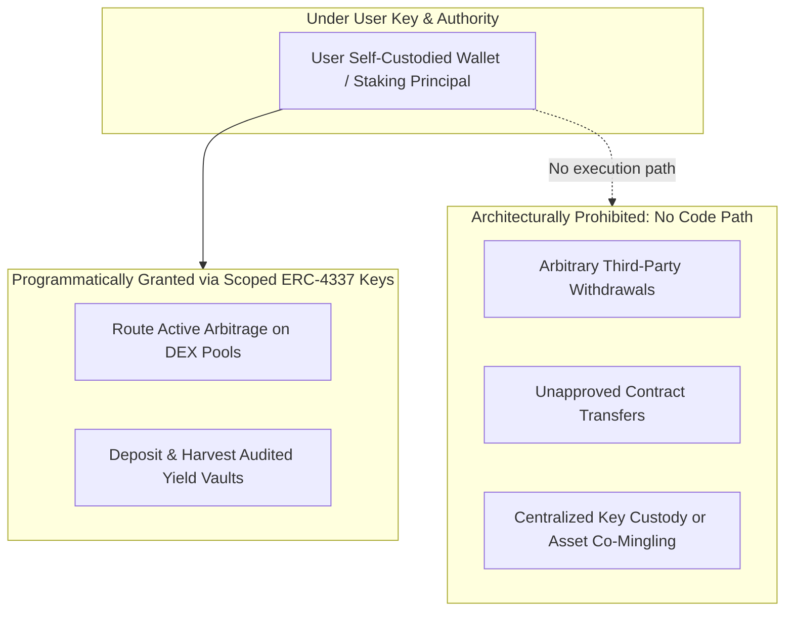

The term "non-custodial" is often applied loosely in decentralized finance. This page defines exactly what non-custodial architecture guarantees on BlackQuant, how our contracts operate, and the associated responsibilities.

BlackQuant is operated by **BlackQuant Labs LLC**, a Delaware limited liability company (File Number: 10814234). The platform operates strictly as non-custodial software: users retain full ownership and control of their wallets, while the platform facilitates execution without ever taking custody of digital assets.

## The core security guarantee

**BlackQuant smart contracts are granted permission to execute specific quantitative routes and vault allocations. They are never granted permission to withdraw user capital.**

These constraints are enforced at the smart contract bytecode level rather than by internal corporate policy:

## Delegated non-custodial execution and automated fail-safes

For automated Smart Executors (such as Liquidity Optimizer, MEV Arbitrage, and Yield Farmer), BlackQuant utilizes a delegated non-custodial architecture:

* **Scoped Session Keys (ERC-4337)**: Users delegate temporary, bounded execution permissions to automated routing contracts rather than exposing raw private keys.
* **Predefined Risk Boundaries**: You establish explicit execution ceilings prior to launch, including maximum slippage tolerance, maximum position sizing per pool, and automated stop-out limits.
* **Autonomous In-Bounds Execution**: While market parameters remain inside your bounds, executors operate autonomously 24/7.
* **Automated Fail-Safe Protection**: Any out-of-band market condition triggers an immediate execution halt:
  - Anomalous pool slippage exceeding user thresholds
  - Sudden liquidity dry-up or pool imbalance
  - Rebalancing across unwhitelisted tokens
  When an anomaly is detected, the executor pauses safely and requires explicit one-click user re-authorization.

## Cryptographic separation of concerns

BlackQuant maintains an absolute separation between user trading liquidity and operational platform services:

1. **Non-Custodial Trading Capital**: Resides strictly on-chain under the user's authority or within audited smart contract vaults. The platform never co-mingles, borrows against, or takes custody of user liquidity.
2. **Operational Payment Rails**: Our off-chain ledger tracks subscription plan utilization, performance attribution, and affiliate commissions, reconciling platform fees via decentralized payment gateways without ever touching user principal.

## Architectural security properties

**No platform administrator or support agent can move your on-chain assets.** Execution contracts contain no administrative backdoor or arbitrary drain functions.

**Platform server compromises cannot trigger asset theft.** In the theoretical event that off-chain application servers were compromised, an attacker would have access to application data, but could not initiate withdrawals from non-custodial execution contracts.

**All transactions and vault states are independently verifiable.** Staking allocations, harvest epochs, and arbitrage trades settle on decentralized blockchains. You can verify state directly using block explorers. See [Positions](/platform/positions#on-chain-settlement-and-verification).

## Self-sovereign responsibility

Non-custodial architecture provides protection against centralized custodian insolvency, but requires disciplined personal security:

<Danger>
**Loss of private keys is permanent.** BlackQuant cannot recover lost external wallet keys or reset blockchain addresses. A system architected to allow emergency administrative key recovery would inherently possess the capability to confiscate user capital.
</Danger>

**Network selection must be exact.** Blockchain transfers broadcast to incorrect chains cannot be reversed. This is why our deposit flows lock assets to native networks rather than generic pickers.

**Algorithmic execution follows configured parameters.** Automated Smart Executors trade or compound strictly according to parameters set by you.

## Understanding account balance versus trading capital

It is essential to distinguish between your internal USD account balance and non-custodial trading capital:

| Attribute | USD Account Balance | Staked / Trading Capital |
| --- | --- | --- |
| Primary Purpose | Purchasing subscriptions, add-ons, or staking allocations | Deployed in decentralized DEX pools and yield vaults |
| Accounting Method | Derived from an immutable database ledger | Validated on-chain via smart contract state |
| Custody Classification | Platform ledger balance | Non-custodial on-chain contracts |
| Support Recovery | Crediting and adjustments can be verified by support | Governed strictly by decentralized consensus rules |

<Warning>
Your USD account balance exists to facilitate seamless tool activation and staking without requiring separate on-chain checkouts for every transaction. Keep what you intend to deploy on the platform, and withdraw unallocated capital.
</Warning>

## The Signal Engine cannot trade

The Signal Engine is structurally isolated from execution logic. It processes on-chain market data and publishes statistical indicators. It maintains no programmatic access to private keys or trade dispatch contracts.

## Independent verification and audits

Our open-source smart contract repository is publicly accessible:

<Card title="BlackQuant Smart Contracts" icon="github" href="https://github.com/Blackquant-labs/blackquant-contract">
  View public smart contract repository
</Card>

Core vault routing, collateral verification, and underlying smart contract foundations have been thoroughly audited by **OpenZeppelin** and **Trail of Bits**. For complete PDF audit reports, plain-English summaries, and scope details, visit [Audit reports](/security/audit-reports) and [https://blackquantlabs.com/audits](https://blackquantlabs.com/audits).

## Related documentation

* [Corporate and regulatory positioning](/security/corporate-and-regulatory): BlackQuant Labs LLC registration and governance.
* [Two-factor authentication](/security/two-factor-authentication): Protecting your account access.
* [Audit reports](/security/audit-reports): Full third-party security assessments.
