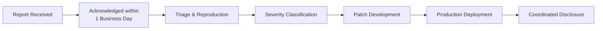

Please report suspected security vulnerabilities to **security@blackquantlabs.com**.

<Info>
**Good-faith security research is welcomed and encouraged.** Submissions are acknowledged within one business day. BlackQuant commits to not taking legal action against researchers who discover and report vulnerabilities in good faith according to these guidelines.
</Info>

## What to include in your disclosure

| Detail | Purpose |
| --- | --- |
| Clear technical summary | Identifies the nature of the vulnerability |
| Step-by-step reproduction guide | Enables our engineering team to replicate the behavior |
| Potential impact assessment | Clarifies what privileges or data could be accessed |
| Affected endpoints or contracts | Specific URL, route handler, or smart contract address |
| Supporting proof of concept | Request/response headers, script snippets, or transaction hashes |

Reports with reproducible proofs of concept are triaged and investigated promptly.

## In-scope components

* Application routing and API endpoints under `app/api/`
* Open-source execution contracts at [Blackquant-labs/blackquant-contract](https://github.com/Blackquant-labs/blackquant-contract)
* Authentication, session validation, and 2FA middleware
* Payment webhook handlers (`/api/deposit/ipn`)
* Any flaw permitting cross-account data exposure or unauthorized privilege escalation

## Out-of-scope items

* Automated vulnerability scanner outputs without demonstrated exploitation
* Missing HTTP security headers without actionable exploit paths
* Social engineering or phishing attempts against personnel or members
* Physical security attacks against server facilities
* Distributed Denial of Service (DDoS) attacks
* Deficiencies in third-party blockchain validators or upstream node providers
* Typographical errors or stylistic issues on marketing pages

## Research rules of engagement

**Please ensure you:**
* Conduct testing exclusively against accounts you own or control.
* Halt testing immediately once a vulnerability has been verified.
* Allow reasonable coordination time for remediation prior to public disclosure.

**Please avoid:**
* Accessing, altering, or destroying data belonging to other members.
* Disrupting live service operations for active platform users.
* Extracting data beyond the minimal evidence required for demonstration.

## Vulnerability remediation process

## Severity classification

| Severity | Operational Examples |
| --- | --- |
| **Critical** | Unauthorized withdrawal of capital; total authentication bypass |
| **High** | Access to another user's ledger data; administrative privilege escalation |
| **Medium** | Authentication weaknesses requiring complex user interaction; sensitive metadata exposure |
| **Low** | Minor information leakage with minimal impact or requiring improbable conditions |

## Disclosure timing and ethics

<Danger>
**Do not release exploit scripts publicly before a verified patch is deployed.** Financial systems require disciplined disclosure to protect user capital. Our security team coordinates public disclosure timelines with researchers collaboratively.
</Danger>

## Related documentation

* [Audit reports](/security/audit-reports): Published third-party security audits from OpenZeppelin and Trail of Bits.
* [The custody model](/security/custody-model): Non-custodial architectural boundaries.
