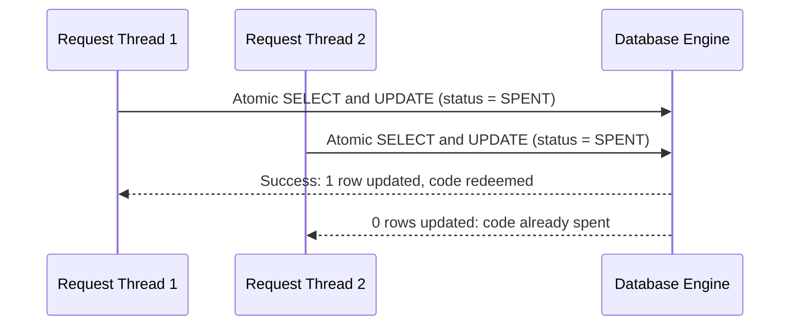

Setup instructions are in [Secure your account](/getting-started/secure-your-account). This page covers the architectural implementation and operational security parameters.

## Authentication mechanism

**TOTP (Time-based One-Time Password)**: Rotating six-digit cryptographic tokens conforming to RFC 6238. Compatible with standard authenticator applications.

## Cryptographic secret management

Your TOTP secret key is **encrypted at rest** using AES-256-GCM. Plaintext secrets are never stored in the database and are never displayed after initial enrollment.

<Info>
In the rare event that platform encryption keys are rotated, stored TOTP secrets can no longer be decrypted, prompting users to re-enroll.

This scenario transitions to recovery mode rather than locking accounts: users authenticate using their single-use recovery codes to provision fresh authenticators.
</Info>

## Clock drift and skew tolerance

Tokens accommodate **one step of tolerance** (±30 seconds) around the current time window, ensuring normal mobile clock variations do not prevent authentication.

Consistent token rejections usually indicate local clock drift exceeding 30 seconds. Confirm that your device has network time synchronization enabled.

## Single-use recovery codes

**Ten single-use cryptographic codes**, issued at enrollment and displayed once.

### Atomic race-condition prevention

Redeeming a recovery code marks the code as spent **within the identical database query that selects it**.

This prevents replay vulnerabilities during simultaneous requests. Conventional multi-step lookups create a brief race window where concurrent threads could authenticate against the same code:

### Regenerating recovery codes

Navigate to **2FA / Auth Guard → Regenerate recovery codes** to provision ten fresh codes and immediately invalidate all outstanding previous codes. Perform this after using several backup codes or if stored copies may have been seen.

## Global middleware enforcement

Two-factor authentication is enforced directly at the **API authentication layer**, not merely within client-side React form components. Direct API callers cannot bypass secondary authentication.

## Uniform authentication responses

Incorrect passwords, invalid 2FA tokens, consumed recovery codes, and accounts without a password (created via GitHub OAuth) return **uniform authentication error responses**.

<Info>
Uniform error handling prevents brute-force timing attacks and prevents the sign-in endpoint from functioning as an oracle to discover registered email addresses or 2FA states.
</Info>

## Disabling 2FA

Disabling two-factor authentication requires entering an active 2FA token first. Disabling automatically revokes all existing recovery codes.

## Session lifetime management

| "Remember me" Selection | Session Lifetime |
| --- | --- |
| Checked | 30 days |
| Unchecked | 24 hours |

Session cookies default to the maximum window while shorter lifetimes are enforced via signed expiration timestamps inside the token itself. On shared workstations, leave the box unchecked and sign out explicitly.

## Related documentation

* [Account recovery](/account-recovery)
* [Secure your account](/getting-started/secure-your-account)
